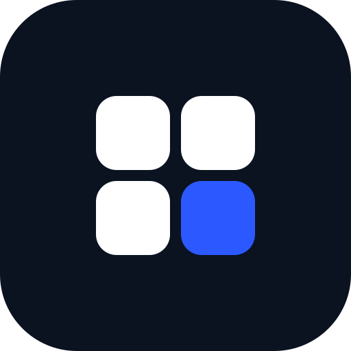
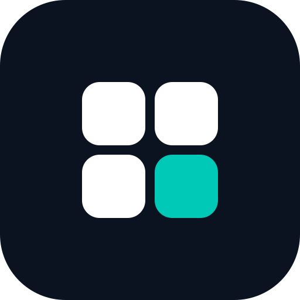

  

<h3 align="center">ЦИФРОВАЯ ИНФРАСТРУКТУРА ДЛЯ МАЛОГО БИЗНЕСА И ОБРАЗОВАНИЯ</h3>

  <strong>Меньше барьеров. Больше пользы в ежедневной работе.</strong> 
  Practical digital infrastructure for small business and education.

---

## Миссия

**Сначала задача бизнеса. Затем — сервис, который её решает.**

Мы превращаем реальные потребности предприятий и учебных заведений в сервисы с полезными функциями, простым подключением и минимальными наценками. Критерий успеха каждого проекта: стало ли клиенту легче работать. Ориентир — практическая сторона [платформы МСП.РФ](https://corpmsp.ru/to-business/msp-rf/).

## Три линейки

Форма знака одна, акцент — разный. Продукты не получают собственные логотипы: они получают ключ своей линейки.

| Ключ | Линейка | Что внутри |
|:---:|---|---|
|  | **МСП** · лайм | Локальные маркетплейсы, цифровые витрины, программы лояльности, автоматизация точек |
|  | **Образование** · синий | Вузы, колледжи, школы: единый вход, роли, отчётность, интеграции |
|  | **Финтех** · бирюзовый | Платежи, эквайринг, фискализация, платёжные интеграции |

## Портфель

| Проект | Что это | Где |
|---|---|---|
| **Lovii** | SaaS-платформа локальных маркетплейсов: витрина и лояльность для кафе, пекарен, магазинов и салонов; жителям — единый кэшбэк района | [lovii.ru](https://lovii.ru) · [документация](https://axiiom-ru.github.io/lovii/) |
| **AXIIOM** | Студия разработки: сайты, мобильные приложения, UI/UX, финтех-решения | [axiiom.ru](https://axiiom.ru/) |
| **АТМОСФЕРА** | Digital-агентство полного цикла: лидогенерация, интеграции, автоматизация рекламы и CRM | [arental.ru](https://arental.ru)|
| **mock-services** | Тестовый банк-эквайринг и ОФД по официальным протоколам: Т-Банк, ЮKassa, АТОЛ, Альфа, Сбер, ВТБ | [mock-services](https://axiiom.ru/mock-services/) |

**Экономика Lovii** — эталон подхода к ценообразованию: подключение бесплатно, оплата с чека, совокупная нагрузка на точку по заказу — не более 10%, включая эквайринг ([тарифы](https://github.com/lovii-ru/lovii-docs/blob/main/canon/PARAMS.md)). Платформа не перепродаёт товары и не хранит деньги клиентов: расчёты идут через банковского партнёра.

## Как мы работаем

`ПОТРЕБНОСТЬ` → `ИНФРАСТРУКТУРА` → `ЗАПУСК` → `УЛУЧШЕНИЕ`

| Этап | Фокус |
| --- | --- |
| **Потребность** | Находим практическую задачу предприятия. |
| **Инфраструктура** | Создаём сервис, который её решает. |
| **Запуск** | Делаем решение доступным: бесплатное подключение, минимальные наценки. |
| **Улучшение** | Развиваем проект, сохраняя фокус на практической ценности. |

## Принципы

- **Практическая польза.** Каждый проект помогает в реальной работе.
- **Доступная экономика.** Минимальные наценки, оплата по факту пользы.
- **Функции по делу.** Полезность вместо сложности ради сложности.
- **Ясная ответственность.** У каждого проекта и результата есть ответственные.
- **Временный мандат.** Команды формируются под задачу; продолжение требует ясной цели.

## Участие

Предложить задачу или идею — [Issue](https://github.com/rucorp/rucorp/issues). Изменить документацию — [Pull Request](https://github.com/rucorp/rucorp/pulls) (для крупного — сначала Issue). В предложении укажите: кому и какую задачу решаем, ожидаемый результат, необходимые роли.

## Проект

### [Lovii](https://lovii.ru)

SaaS-платформа для локального бизнеса и его клиентов. Торговая точка получает собственную цифровую витрину и программу лояльности, жители района — единый способ копить баллы и получать кэшбэк у местных предприятий.

- **Подключение бесплатное**, оплата — с чека, без затрат на старте.
- **Нагрузка на торговую точку — не более 10%** от суммы заказа, включая эквайринг.
- Платформа не перепродаёт товары и не хранит деньги клиентов: расчёты идут через банка-партнёра.

Подробности и документы — в [lovii-docs](https://github.com/lovii-ru/lovii-docs).

## Принципы

- **Практическая польза.** Каждый проект должен помогать в реальной работе предприятия.
- **Доступная экономика.** Минимальные наценки, никаких обязательных платежей за вход.
- **Функции по делу.** Полезность важнее сложности.
- **Ясная ответственность.** У каждого результата есть ответственный.

## Как помочь

Предложить задачу, идею или задать вопрос — в [Issues](https://github.com/rucorp/rucorp/issues).
Исправить документацию или правила — через [Pull Request](https://github.com/rucorp/rucorp/pulls).

Подробное описание миссии, модели работы и тарифов — в [README репозитория](https://github.com/rucorp/rucorp#readme).

---

Материалы распространяются на условиях [Unlicense](LICENSE).

---

  RuCorp · <a href="https://lovii.ru">lovii.ru</a> · первый проект — <a href="https://lovii.ru">Lovii</a> 
  Материалы — <a href="LICENSE">Unlicense</a>. Бренд: знак «Модуль», Inter, Ink&nbsp;#0B1220 + Lime&nbsp;#C8F751.

